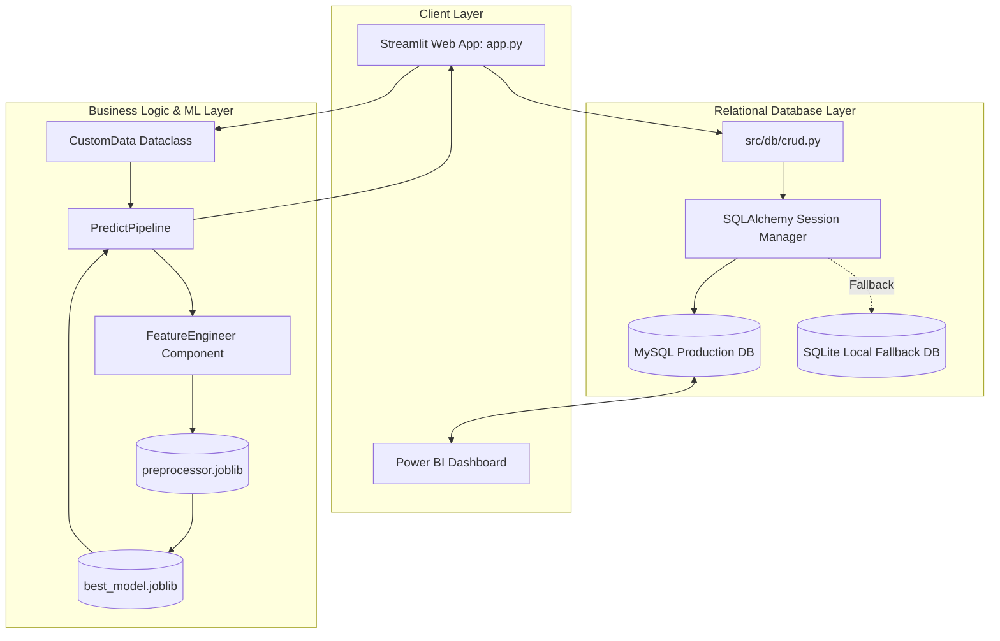
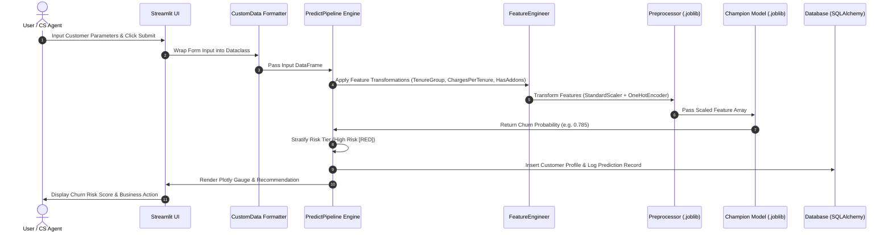

# 🏗️ Deep-Dive Architecture Specification

This document details the architectural design, data pipelines, database ERD schema, and inference flow for **ChurnGuard Enterprise**.

---

## 1. High-Level Enterprise System Architecture



---

## 2. Real-Time Prediction Execution Flow



---

## 3. Database Schema Design (ERD)

```mermaid
erdiagram
    CUSTOMERS ||--o{ PREDICTIONS : "generates prediction history"

    CUSTOMERS {
        string customer_id PK
        string gender
        int senior_citizen
        string partner
        string dependents
        int tenure
        string phone_service
        string internet_service
        string contract
        string payment_method
        decimal monthly_charges
        decimal total_charges
        datetime created_at
    }

    PREDICTIONS {
        int prediction_id PK
        string customer_id FK
        string prediction
        decimal probability
        string risk_level
        decimal confidence_score
        string model_name
        datetime prediction_time
    }

    MODEL_INFO {
        int model_id PK
        string model_name
        string algorithm
        decimal accuracy
        decimal precision_score
        decimal recall_score
        decimal f1_score
        decimal roc_auc
        datetime training_date
        string version
    }

    APPLICATION_LOGS {
        int log_id PK
        string event_type
        string description
        string status
        datetime created_at
    }
```

---

## 4. Machine Learning & Preprocessing Pipeline

```text
Raw Features (19) 
       │
       ▼
Feature Engineering (TenureGroup, ChargesPerTenure, HasAddons) ──► Total Features (23)
       │
       ▼
ColumnTransformer ──► [StandardScaler for Numerical] + [OneHotEncoder for Categorical]
       │
       ▼
Transformed Array (52 Sparse Features)
       │
       ▼
Gradient Boosting Classifier (predict_proba)
       │
       ▼
Probability Score (0.0 to 1.0) ──► Continuous Risk Level Stratification
```

---

## 5. Deployment Architecture

```text
GitHub Repo (main branch)
       │
       ▼
Streamlit Community Cloud / Render PaaS
       │
       ├── Python 3.10 Runtime Environment
       ├── Requirements Installation (pip install -r requirements.txt)
       ├── Streamlit Headless Web Server (app.py)
       └── Database Connection Pool (MySQL with SQLite local fallback)
```
