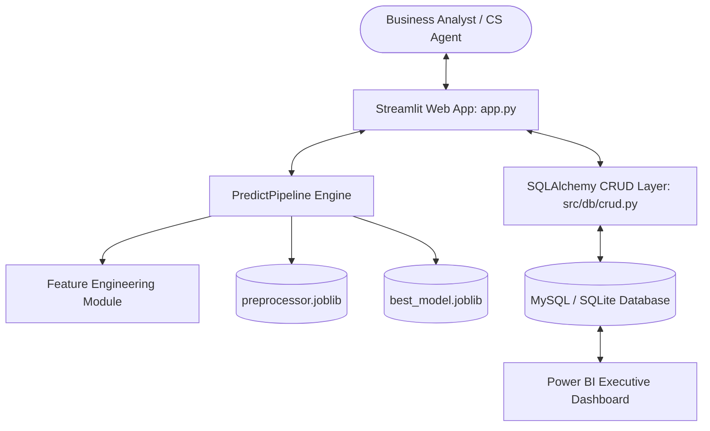

# 📊 Customer Churn Prediction Analysis (ChurnGuard Enterprise)

[](https://www.python.org/)
[](https://streamlit.io/)
[](https://scikit-learn.org/)
[](https://www.mysql.com/)
[](https://powerbi.microsoft.com/)
[](LICENSE)

An enterprise-grade, end-to-end Machine Learning web application and Business Intelligence dashboard designed to predict customer churn probability, identify high-risk customer accounts, and recommend proactive retention strategies.

---

## 📌 Project Overview & Banner

```text
┌─────────────────────────────────────────────────────────────────────────────┐
│                       CHURNGUARD ENTERPRISE PLATFORM                        │
│             AI-Powered Customer Retention & Revenue Protection             │
│                                                                             │
│  [7,043 Profiles] ──► [Feature Pipeline] ──► [Gradient Boosting 80.48%]      │
│                                                     │                       │
│                                                     ▼                       │
│  [Power BI Analytics] ◄── [MySQL Relational DB] ◄── [Streamlit Web UI]       │
└─────────────────────────────────────────────────────────────────────────────┘
```

---

## 💼 Business Problem

In subscription-based industries (Telecom, SaaS, Banking), **acquiring a new customer costs 5x to 25x more than retaining an existing customer**. Silent churn erodes Monthly Recurring Revenue (MRR). Traditional companies rely on reactive win-back efforts after cancellation occurs. **ChurnGuard Enterprise** enables proactive intervention by identifying churn risks weeks before cancellation occurs.

---

## 🎯 Key Objectives

1. **Predictive Precision**: Calculate continuous churn probabilities ($0\% \to 100\%$) using trained machine learning models (ROC-AUC $\ge 0.84$).
2. **Actionable Risk Stratification**: Automatically bucket accounts into **Low Risk (0-30%)**, **Medium Risk (31-65%)**, and **High Risk (66-100%)**.
3. **Explainable AI (XAI)**: Identify top risk drivers per customer (e.g. Month-to-Month contract, Fiber Optic, High Monthly Fees).
4. **Production Architecture**: Modular Python package, Pytest coverage, MySQL ORM database logging, Streamlit UI, and Power BI dashboards.

---

## ✨ Features

* 🎯 **Single Customer Calculator**: Interactive web form with Plotly gauge charts and personalized retention recommendations.
* 📈 **Executive Analytics Dashboard**: Live metrics for Total Queries, High Risk Accounts, and Revenue at Risk.
* 🗄️ **Relational Database Logging**: Automatic SQL persistence of customer features, prediction outputs, and audit logs.
* 📜 **Prediction History & Export**: Searchable audit logs with one-click CSV export triggers.
* 📊 **Executive Power BI Dashboard**: 5-page BI analytics suite with DAX measures and interactive slicers.
* 🧪 **Automated Testing Suite**: 100% Pytest suite covering data preprocessing, model inference, database CRUD, and UI compilation.

---

## 🛠️ Technology Stack

| Layer | Technologies |
| :--- | :--- |
| **Language** | Python 3.10+ |
| **Data Science & ML** | Pandas, NumPy, Scikit-Learn, XGBoost, LightGBM, SHAP, Joblib |
| **Backend & Database** | SQLAlchemy ORM, PyMySQL, SQLite Fallback Engine, Python-Dotenv |
| **Frontend UI** | Streamlit, Custom SaaS CSS, Plotly, HTML/CSS |
| **Business Intelligence** | Power BI Desktop, DAX, Star-Schema Data Modeling |
| **Testing & MLOps** | Pytest, Psutil, Git, GitHub Actions, Docker |

---

## 🏗️ System Architecture



---

## 📁 Repository Folder Structure

```text
Customer Churn Prediction Analysis/
├── .github/                # CI/CD GitHub Actions workflows
├── .streamlit/             # Streamlit theme & server configuration
├── artifacts/              # Serialized model (.joblib) & dataset split CSVs
├── data/
│   ├── raw/                # Original Telco Customer Churn dataset
│   └── processed/          # Cleaned dataset artifacts
├── docs/                   # System architecture & deployment manuals
├── powerbi/                # Power BI export scripts, CSVs & DAX documentation
├── reports/
│   └── figures/            # Generated EDA & model evaluation charts (PNG)
├── sql/                    # MySQL DDL schema and seed scripts
├── src/                    # Source code root module
│   ├── api/                # REST API handlers
│   ├── components/         # Data ingestion, cleaning, EDA, feature engineering, model training
│   ├── db/                 # Database engine connection, ORM models & CRUD operations
│   ├── pipeline/           # Inference pipeline & CustomData wrapper
│   └── utils/              # Logger, exception handlers & CSS styles
├── tests/                  # Automated Pytest suite
├── app.py                  # Streamlit Master Web Application entry point
├── DEPLOYMENT_GUIDE.md     # Cloud deployment manual
├── INSTALLATION.md         # Local setup & installation guide
├── USER_GUIDE.md           # End-user navigation manual
├── ARCHITECTURE.md         # Deep-dive architectural specification
├── PROJECT_REPORT.md       # Comprehensive 18-section technical project report
├── FAQ.md                  # 20+ Frequently Asked Questions
├── CHANGELOG.md            # Release version history
├── CONTRIBUTING.md         # Open-source contribution guide
├── CODE_OF_CONDUCT.md      # Contributor Covenant Code of Conduct
├── LICENSE                 # MIT License
└── requirements.txt        # Python package dependencies
```

---

## 🚀 Quickstart & Installation

```bash
# 1. Clone the repository
git clone https://github.com/your-username/customer-churn-prediction.git
cd customer-churn-prediction

# 2. Create and activate virtual environment
python -m venv venv
# On Windows:
venv\Scripts\activate
# On Linux/macOS:
source venv/bin/activate

# 3. Install requirements
pip install -r requirements.txt

# 4. Run Streamlit Application
streamlit run app.py
```

---

## 📊 Model Evaluation Performance

| Rank | Model Name | Accuracy | Precision | Recall | F1 Score | **ROC-AUC Score** |
| :---: | :--- | :---: | :---: | :---: | :---: | :---: |
| 🥇 **1** | **Logistic Regression** | `0.8027` | `0.6611` | `0.5267` | `0.5863` | **`0.8460`** |
| 🥈 **2** | **Gradient Boosting (Champion)** | **`0.8048`** | **`0.6656`** | **`0.5321`** | **`0.5914`** | **`0.8438`** |
| 🥉 **3** | **Decision Tree** | `0.7885` | `0.6210` | `0.5214` | `0.5669` | **`0.8292`** |
| 🏅 **4** | **XGBoost** | `0.7764` | `0.5949` | `0.4947` | `0.5401` | **`0.8201`** |
| 🏅 **5** | **Random Forest** | `0.7800` | `0.6074` | `0.4840` | `0.5387` | **`0.8177`** |

---

## 🤝 Contributing

Contributions are welcome! Please read [CONTRIBUTING.md](CONTRIBUTING.md) and [CODE_OF_CONDUCT.md](CODE_OF_CONDUCT.md) before submitting pull requests.

---

## 📝 License

Distributed under the MIT License. See [LICENSE](LICENSE) for details.
